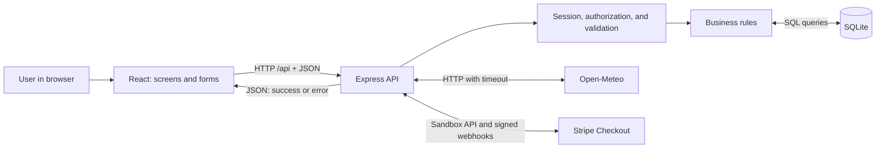
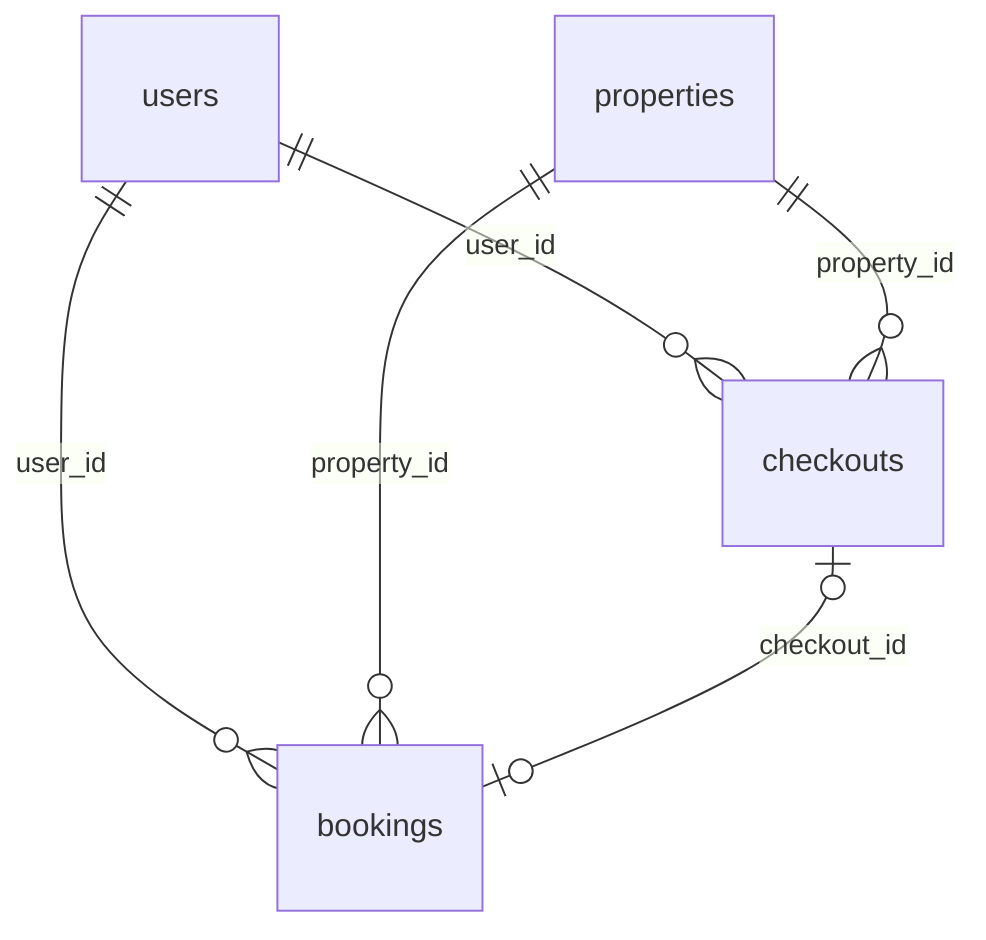

# StayFinder Architecture

Updated: October 17, 2026. This document describes the current local implementation.

## 1. System Purpose

StayFinder is a vacation accommodation booking demo for learning and practicing UI, API, and SQL testing and presenting a portfolio project in interviews. Each catalog listing represents one accommodation unit. The initial users and listings are fictional sample data.

The system has three main parts:

| Part     | Responsibility                                                      | Technology                    | Location                                   |
| -------- | ------------------------------------------------------------------- | ----------------------------- | ------------------------------------------ |
| Frontend | Screens, forms, navigation, and displaying server responses         | React + Vite, JavaScript      | `client/`                                  |
| Backend  | Request handling, authentication, authorization, and business rules | Node.js + Express, JavaScript | `server/`                                  |
| Database | Persistent storage for users, accommodation, bookings, and sessions | SQLite through better-sqlite3 | `server/data/stayfinder.sqlite` by default |

React is a library for building interfaces from components. Node.js runs JavaScript outside the browser. Express provides tools for handling HTTP requests. SQLite stores data in a file without requiring a separate database service.

## 2. System Overview



HTTP is a protocol for exchanging requests and responses. JSON is a text format for transferring data, such as `{"guests":2}`. The API is the interface the server exposes to the frontend and testing tools. An endpoint combines an HTTP method and a URL, such as `POST /api/checkouts`.

The browser does not open SQLite directly. It requests information from the server, which checks permissions and input, accesses the database, and returns a response.

## 3. Project Structure

```text
stayfinder/
├── client/
│   ├── index.html                 Base HTML document used by React
│   ├── vite.config.js             Vite configuration and API proxy
│   ├── public/
│   │   ├── images/                Local sample photographs
│   │   └── stay-fallback.svg       Fallback for image loading errors
│   └── src/
│       ├── main.jsx               Main screens and routing
│       ├── admin.jsx              Administration screens
│       ├── shared.jsx             API requests and shared UI helpers
│       └── styles.css             Styling and responsive layouts
├── server/
│   ├── .env.example               Example environment configuration
│   ├── data/                      Local database; excluded from Git
│   ├── migrations/
│   │   └── 001_initial.sql        Tables, constraints, indexes, and triggers
│   ├── src/
│   │   ├── index.js               Server entry point
│   │   ├── app.js                 API routes, authorization, and business rules
│   │   ├── payments.js            Checkout holds, verification, and refunds
│   │   ├── config.js              Configuration and business date
│   │   ├── database.js            Connection, migrations, seed, and reset
│   │   ├── session-store.js       SQLite session storage
│   │   └── openapi.js             API contract definition
│   └── test/
│       └── api.test.js            HTTP and SQLite integration tests
├── docs/                          Requirements, architecture, and verification
├── package.json                   Shared project commands
├── package-lock.json              Resolved dependency versions
└── README.md                      Setup, usage, and limitations
```

JSX is syntax for describing an HTML-like interface inside JavaScript. React component files in this project use the `.jsx` extension.

`client` and `server` are npm workspaces: separate packages managed from a shared project root. `node_modules` contains installed dependencies rather than application source code. An `automation/` directory also existed during inspection, but the file scan found no automation files inside it; it is not registered as a workspace in the current root `package.json`.

## 4. Frontend

### Screens and Routing

`client/src/main.jsx` contains the `App` component and the main screens. React Router selects a screen based on the browser URL:

| Path            | Screen                                                         |
| --------------- | -------------------------------------------------------------- |
| `/`             | Home, search, and featured destinations                        |
| `/stays`        | Catalog, filtering, sorting, and pagination                    |
| `/stays/:id`    | Accommodation details, weather, and booking                    |
| `/login`        | Sign in                                                        |
| `/bookings`     | The current user's bookings and cancellation                   |
| `/admin`        | Accommodation, user, and booking management                    |
| `/checkout/:id` | Payment verification, hold recovery, and checkout cancellation |

`:id` is a placeholder for a record identifier, such as `/stays/1`.

`client/src/checkout.jsx` contains the payment return/recovery page and pending checkout list. `client/src/admin.jsx` contains the administration components. Hiding a screen or button improves the user experience, while the server independently enforces the required permissions.

### Shared Helpers and UI State

`client/src/shared.jsx` provides:

- `api()` and `send()` for server requests and JSON responses.
- `useLoad()` for loading, data, error, and retry state.
- `Load` and `ErrorBox` for displaying loading and error states.
- `Photo` for bundled sample images and a fallback on image loading errors.
- `money()` for displaying amounts stored in cents as dollars.

React keeps temporary screen state in browser memory, such as form values and search results. Persistent business data is stored in SQLite, not in localStorage.

## 5. Backend

`server/src/index.js` calls `createApp()` from `app.js` and starts listening for requests. The local server binds to `127.0.0.1`. The port is configurable and defaults to `3001`.

`app.js` contains API routes, validation helpers, authorization checks, and catalog/admin database operations. `payments.js` handles checkout, holds, payment verification, and refunds. The application does not introduce a separate controller/service/repository hierarchy.

Requests pass through middleware: functions that run as part of the request-handling pipeline. The application configures:

- Security headers through Helmet; Content Security Policy (CSP) is disabled in the current implementation.
- JSON body parsing with a size limit.
- Origin checks for requests that modify data, when the Origin header is present.
- Session loading and lookup of the current active user.
- `auth` checks for signed-in users and `admin` checks for administrators.
- Centralized error handling at the end of the pipeline.

An origin identifies a browser request's protocol, hostname, and port. Authorization and input validation are enforced on the server.

API errors use a consistent structure:

```json
{
  "error": {
    "code": "BOOKING_CONFLICT",
    "message": "This accommodation is unavailable for these dates."
  }
}
```

## 6. Database

### Tables and Relationships

The business tables are defined in `server/migrations/001_initial.sql`. The migration tracking table is created by `database.js`.

| Table        | Main data                                                                                    |
| ------------ | -------------------------------------------------------------------------------------------- |
| `users`      | ID, name, unique email, password hash, role, and active status                               |
| `properties` | Name, destination, description, price in cents, capacity, amenities, images, and coordinates |
| `bookings`   | User and property IDs, dates, guests, nights, stored booking prices, and status              |
| `sessions`   | Session ID, expiration, and serialized session data                                          |
| `checkouts`  | Temporary holds, price snapshots, Stripe references, expiry and refund recovery              |
| `migrations` | Applied migration filenames and application timestamps                                       |



One user can have many bookings. One accommodation unit can have many bookings on different dates. Each booking belongs to one user and one unit through foreign keys: fields that reference identifiers in other tables.

The association between a session and a user is stored inside the session data. The `sessions` table does not have a `user_id` foreign-key column. Property amenities and images are stored as JSON strings in table columns.

### Data Integrity

`database.js` enables foreign keys, Write-Ahead Logging (WAL), and a five-second busy timeout. WAL allows readers to operate alongside a writer; SQLite still permits only one writer at a time. The busy timeout allows a connection to wait for a lock up to the configured duration.

The database also defines:

- Case-insensitive unique user emails.
- CHECK constraints, such as positive prices and a booking total equal to nights multiplied by the stored nightly price.
- Indexes for availability searches and booking ownership queries.
- Triggers that reject overlapping confirmed bookings on insert and update. A trigger is SQL that the database automatically executes in response to a data change.

## 7. Local Startup and Communication

Run the following commands from the project root.

### Development Mode

```powershell
npm run dev
```

The root command starts two processes together:

| Process | Default address         | Responsibility                                      |
| ------- | ----------------------- | --------------------------------------------------- |
| Vite    | `http://localhost:5173` | Serve the frontend and update it during development |
| Express | `http://localhost:3001` | Handle API requests and database access             |

The frontend uses relative URLs such as `/api/properties`. The proxy in `client/vite.config.js` forwards requests beginning with `/api` to the backend on port `3001`. A proxy is an intermediary that forwards requests to another server.

### Local Built Version

```powershell
npm run build
npm start
```

The build creates `client/dist`. When this directory exists, Express serves both the frontend files and the API on port `3001`. This is a way to check the built application locally, not a complete public deployment configuration.

SQLite is opened by the server process and does not require a separate startup command. Full installation, migration, and seed instructions are in the [README](../README.md).

## 8. Login Flow

1. The `Login` component in `client/src/main.jsx` collects an email and password and sends them through `send()` to `POST /api/auth/login`.
2. The server validates the input and looks up an active user by email.
3. `bcrypt.compare()` checks the submitted password against the stored hash. A hash is a one-way value used for verification, not an encrypted password that the application decrypts.
4. On success, the server regenerates the session ID, stores `userId` in the session, and saves it through `SQLiteSessionStore` in the `sessions` table.
5. The browser receives a cookie named `stayfinder.sid` containing a signed session identifier. The cookie uses HttpOnly and SameSite=Lax. In production mode, it also uses Secure and requires HTTPS.
6. The server returns public user information without the password hash, and the frontend updates the signed-in user in React state.
7. On subsequent requests, the browser sends the cookie. The server loads the session and the active user and role from the database. Disabling a user therefore takes effect on their next request.
8. `POST /api/auth/logout` destroys the session and clears the cookie.

A session is server-side information that identifies a signed-in user across requests. The cookie holds its identifier, while the session contents are stored on the server. The default expiration period is one day.

## 9. Payment and Booking Creation Flow

1. The Detail screen requests an availability quote. This does not hold dates.
2. Continue to payment calls POST /api/checkouts with an Idempotency-Key. An immediate SQLite transaction creates a hold and snapshots dates, guests, price and callback origin.
3. The server creates a hosted, card-only Stripe sandbox Checkout session and redirects the browser. Holds last approximately 31 minutes and block overlapping reservations.
4. The browser enters a test card on Stripe. No card number or CVC reaches StayFinder.
5. A signed webhook or authenticated owner sync retrieves the authoritative Stripe session. The server verifies identity, metadata, currency, amount and sandbox mode.
6. A paid, still-valid checkout creates exactly one confirmed booking in an immediate transaction. A unique checkout reference prevents duplicate fulfillment.
7. Expired/cancelled/ineligible late payments receive a full test refund instead of a booking. A background reconciliation loop recovers unfinished payments/refunds on startup and every 15 seconds.
8. Cancelling an eligible paid booking durably records cancellation and refund intent, releases availability, and requests the full refund. Provider failure leaves an explicit pending/failed status for safe recovery.

Direct POST /api/bookings is disabled. Existing bookings remain as legacy unpaid records. See [payments.md](payments.md) for the endpoint contract, hold and refund state machines, test setup and limitations.

## 10. Business Rules and Their Locations

| Rule                                                                                       | Main enforcement location                                                                              |
| ------------------------------------------------------------------------------------------ | ------------------------------------------------------------------------------------------------------ |
| Check-in cannot be in the past; check-out must follow check-in; maximum stay is 365 nights | `dates()` in `server/src/app.js`                                                                       |
| Guests must be positive integers within the unit's capacity                                | `integer()` and `quote()` in `app.js`                                                                  |
| Price equals nights multiplied by nightly price, in USD cents, without fees                | `quote()` in `app.js`; snapshot and verification in `payments.js`                                      |
| Booking prices remain unchanged after listing price changes                                | `nightly_price_cents` and `total_cents` in `bookings`                                                  |
| Confirmed bookings and active checkout holds cannot overlap                                | Immediate transactions in `payments.js`; triggers in `001_initial.sql` and `002_checkout_payments.sql` |
| Check-out day is not an occupied night                                                     | Overlap conditions in `available()` and SQL                                                            |
| Initial cancellation is allowed only before check-in day; repeats do not duplicate refunds | `cancelBooking()` and `refund()` in `payments.js`                                                      |
| Users can view and cancel only their own bookings                                          | `user_id` conditions in `app.js` queries                                                               |
| Deactivation blocks new bookings and preserves existing bookings                           | `property()` and Admin routes in `app.js`                                                              |
| Email must be unique                                                                       | UNIQUE constraint on `users`                                                                           |

Idempotent cancellation means repeating a successful cancellation does not apply another change or update its original cancellation timestamp.

The business date is calculated by `today()` in `config.js`, using `APP_TIMEZONE`, which defaults to `Asia/Jerusalem`.

## 11. Weather Integration

The browser calls `GET /api/weather?propertyId=1`. The server loads the unit's coordinates and requests current weather from Open-Meteo. This is current destination weather, not a forecast for the selected booking dates.

The server validates the provider response and limits how long it waits. Network failure, timeout, HTTP error, or invalid response data returns `503 WEATHER_UNAVAILABLE`. Booking creation does not depend on a successful weather request.

`WEATHER_BASE_URL` allows the upstream service to be replaced with a controlled test stub, and `WEATHER_TIMEOUT_MS` sets the timeout. The upstream URL comes from trusted server configuration, not an arbitrary user-supplied URL. The README explains the provider choice and links to its terms.

## 12. Migrations, Seed, and Configuration

A migration is a recorded database schema change. `migrate()` in `database.js` applies SQL files in order and tracks applied files in `migrations`. It also runs when the server application is created.

Seed data is the initial sample dataset. `seed()` in the same file creates one Admin, two Customers, and twelve accommodation units across four destinations. It requires an empty database and does not run automatically on every startup.

```powershell
npm run db:migrate
npm run db:seed
```

The explicit practice-data reset command is `npm run db:reset`. It deletes business data and sessions from the configured database, then recreates the sample data. It preserves migration history.

Configuration is loaded by `config.js`. An example is provided in `server/.env.example`; the server workspace commands load `server/.env` when it exists. Settings include `PORT`, `DB_PATH`, `SESSION_SECRET`, `APP_ORIGIN`, `APP_TIMEZONE`, and the weather settings. `DB_PATH` can select a separate database for practice or testing.

## 13. API Documentation and Tests

| Resource                                                        | Location                                                     |
| --------------------------------------------------------------- | ------------------------------------------------------------ |
| OpenAPI contract: endpoints, schemas, permissions, and examples | `server/src/openapi.js`                                      |
| Swagger UI                                                      | `http://localhost:3001/api/docs`                             |
| JSON contract                                                   | `http://localhost:3001/api/openapi.json`                     |
| Integration tests                                               | `server/test/api.test.js` and `server/test/payments.test.js` |
| Stripe sandbox setup and behavior                               | [payments.md](payments.md)                                   |
| Requirements and expected behavior                              | [requirements.md](requirements.md)                           |
| Verification results and coverage limits                        | [verification.md](verification.md)                           |
| SQL practice queries                                            | [sql-practice.sql](sql-practice.sql)                         |
| Setup, demo accounts, and limitations                           | [README](../README.md)                                       |

OpenAPI is a structured description of the API contract. Swagger UI renders it as an interface for reading the documentation and sending requests.

`npm test` runs Node tests against a real HTTP server and a separate in-memory SQLite database (`:memory:`). This database exists only for the test process and does not modify the normal practice data. Temporary browser checks are described in the verification report; they are not a full Playwright automation framework.

## 14. Current Implementation Boundaries

The project is intended for learning and local execution. It does not include live payments, email delivery, public registration, password recovery, or a full Playwright framework. Admin tables are not paginated. Weather responses have no local cache. Expired sessions are rejected, but there is no background process to remove their records.

Server code is intentionally concentrated in a small number of files rather than separate services. Sample photographs are bundled locally; admin-added images and fonts may load from external sources. The local verification checks do not replace complete load, security, and accessibility testing before public deployment.

## 15. Stabilization and QA isolation

The frontend adds accessibility.jsx for route focus and native confirmation dialogs, and checkout-request.js for opaque tab-local retry tokens. Business state remains server-side. payments.js persists cancellation recovery and explicit checkout refund status; migration 004_refund_recovery_status.sql adds that field without deleting data. GET checkout responses distinguish a locally expired hold from a provider-verified terminal state and include server time.

The QA launcher in server/scripts/qa.js uses qa-config.js to enforce a separate database under server/data/qa, ports 3002/5174, a distinct session cookie and explicitly configured QA provider credentials. Swagger reflects the configured cookie name. Vite accepts a QA-specific API target. See [the behavior contract](stabilization.md) and [QA guide](qa-environment.md).
