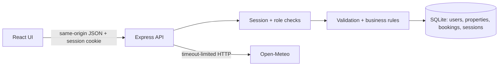

# Architecture

Vite serves React on 5173 and proxies /api to 3001. After building, Express serves client/dist and the API together. Data is stored only in SQLite; React state represents the current screen. No localStorage database is used.

SQLite foreign keys maintain references, CHECK constraints protect basic data, unique email protects identity, indexes speed owner/availability searches, and triggers enforce nonoverlapping confirmed bookings on insert and update. BEGIN IMMEDIATE acquires the write lock before calculating booking availability/price; WAL permits reads during writes and busy_timeout allows a contending connection to wait. Dates are ISO calendar strings so chronological and lexicographic order match. Price snapshots belong to bookings, not mutable property records.

Authentication is session-based: bcrypt verifies the password, session ID is rotated on login, SQLite stores session contents, and every request loads the current active user and role. Public serializers omit password hashes. Customer ownership checks are in SQL. Errors are handled centrally. Validation runs server-side even if native form validation exists.

The UI is split into main routes, admin routes, shared fetch/state helpers and stylesheet to keep the learning project small. The next project can add Playwright UI/API tests against a separate DB_PATH and derive SQL assertions from requirements.md.
